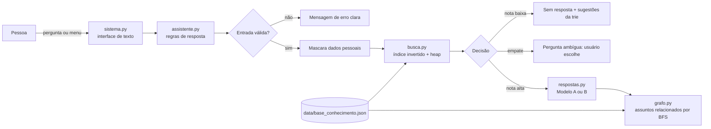
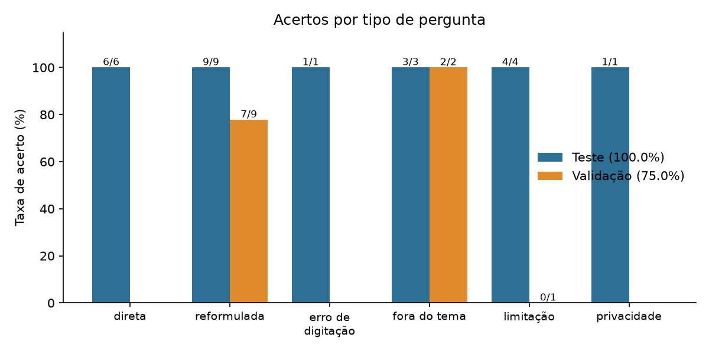

# FIAP - Faculdade de Informática e Administração Paulista

<p align="center">
<a href="https://www.fiap.com.br/">
  
</a>
</p>

<br>

# Citizen Assist AI — assistente de orientação cidadã

**Global Solution 2026.2 — desafio CitizenTech**

## Formato

Trabalho individual

## 👨‍🎓 Autor:
- <a href="https://github.com/deniscereto">Denis Urbano Cereto</a> — RM 569187

## 👩‍🏫 Professores:

### Tutor(a)
- André Tritiack de Farias

### Coordenador(a)
- <a href="https://www.linkedin.com/in/andregodoichiovato/">André Godoi Chiovato</a>

---

## 📜 Descrição

### O problema

Quem procura orientação sobre documentos, serviços públicos ou direitos encontra
informação espalhada em vários sites, com termos difíceis e instruções incompletas.
Muitas vezes a pessoa nem sabe qual é o nome oficial do que procura: ela escreve
"me mandaram embora", e o serviço se chama "seguro-desemprego".

### A solução

O **Citizen Assist AI** é um assistente de texto que recebe uma pergunta (ou a
escolha de um tema), procura a orientação certa em uma **base de informações
conferidas em fontes oficiais** e responde em linguagem simples, sempre com a
**fonte e a data de verificação**. Quando não há informação suficiente, ele **avisa
e não inventa**. Ele não pede dados pessoais e deixa claro que não é um canal oficial.

### Público beneficiado

Cidadãos que precisam de uma primeira orientação sobre serviços do dia a dia,
principalmente pessoas com pouca familiaridade com os portais do governo.

### Temas abordados (18 orientações em 4 temas)

| Tema | Orientações |
|---|---|
| Documentos | Carteira de Identidade Nacional, situação do CPF, e-Título, Carteira de Trabalho Digital, segunda via de certidão |
| Serviços públicos | Níveis da conta gov.br, seguro-desemprego, Cadastro Único, atendimento do INSS, Cartão do SUS com CPF |
| Direitos do consumidor e acesso à justiça | Direito de arrependimento, prazos para reclamar de defeito, Consumidor.gov.br, Defensoria Pública |
| Emergências e proteção comunitária | Telefones 190/192/193/191, Defesa Civil 199, Disque 100, Ligue 180 |

### Arquitetura



---

## 📁 Estrutura de pastas

```text
citizen-assist-ai/
├── data/
│   ├── base_conhecimento.json     # 18 orientações verificadas (fonte + data)
│   ├── sinonimos.json             # termos do dia a dia -> termos da base
│   ├── perguntas_teste.json       # 24 perguntas de teste
│   └── perguntas_validacao.json   # 12 perguntas novas, não usadas no ajuste
├── docs/
│   ├── base_conhecimento.md       # campos, fontes e critérios da base
│   ├── prompts.md                 # os dois modelos de prompt e a comparação
│   ├── resultados_avaliacao.md    # relatório gerado pela avaliação
│   ├── resultados/                # CSVs, indicadores.json e gráfico
│   ├── teste_usabilidade.md       # roteiro de tarefas e teste com usuário
│   └── uso_ia.md                  # uso de IA e validação crítica
├── notebooks/
│   └── analise_resultados.ipynb   # análise dos indicadores (pandas)
├── src/
│   ├── sistema.py                 # ponto de entrada (menu e linha de comando)
│   ├── assistente.py              # fluxo da consulta e regras de resposta
│   ├── base_conhecimento.py       # leitura e validação do JSON
│   ├── busca.py                   # motor de busca
│   ├── grafo.py                   # hierarquia de temas e grafo de assuntos
│   ├── trie.py                    # árvore de prefixos para sugestões
│   ├── respostas.py               # modelos de resposta A e B
│   ├── texto.py                   # normalização e privacidade
│   └── avaliacao.py               # testes, indicadores e comparação
├── tests/                         # 22 testes automatizados (pytest)
├── assets/logo-fiap.png
├── requirements.txt
└── README.md
```

---

## 🗂️ Organização da base, estruturas e estratégia de busca

### Base de conhecimento

Cada orientação é um objeto JSON com **identificador, tema, subtema, título, perguntas
de exemplo, palavras-chave, resumo, orientação em tópicos, referência (título, órgão,
URL) e data de verificação**. Detalhes em [`docs/base_conhecimento.md`](docs/base_conhecimento.md).

- O programa **valida** todos os campos ao iniciar. Registro com erro (campo ausente,
  URL inválida, data fora do formato, id repetido) é ignorado com aviso; o resto
  continua funcionando.
- Arquivo **ausente, vazio ou com JSON inválido** gera mensagem clara, sem travar.
- Para **acrescentar ou corrigir** uma orientação, basta editar o JSON. Nenhuma regra
  do programa muda.

### Estruturas de dados

| Estrutura | Onde | Para quê | Custo |
|---|---|---|---|
| Lista | `registros`, `orientacao` | Guardar as orientações e os tópicos em ordem | — |
| Dicionário (tabela hash) | `por_id`, `por_tema` | Achar uma orientação pelo id ou pelo tema | O(1) |
| Dicionário de dicionários | índice invertido | Palavra -> orientações em que aparece, com peso | O(1) por palavra |
| Árvore (hierarquia) | `montar_hierarquia` | Tema -> subtema -> orientação, usada no menu | — |
| Grafo (lista de adjacência) | `GrafoAssuntos` | Assuntos relacionados (18 vértices, 25 arestas) | BFS O(V+E) |
| Heap | `heapq.nlargest` | Pegar as 3 melhores orientações sem ordenar todas | O(n log k) |
| Trie | `trie.py` | Sugerir palavras-chave pelo início da palavra digitada | O(m) |
| Fila (deque) | BFS | Visitar os assuntos em ordem de proximidade | O(1) por operação |

### Estratégia de busca

1. **Normalização:** minúsculas, sem acentos, sem pontuação, sem palavras vazias
   ("como", "onde", "meu") e com plural reduzido ("certidões" -> "certidao").
2. **Sinônimos:** expressões do dia a dia são trocadas por termos da base
   ("me mandaram embora" -> "demitido"). O arquivo `sinonimos.json` é editável.
3. **Aproximação:** palavra fora do vocabulário é aproximada por radical comum
   ("demitiram" -> "demitido") ou por semelhança de escrita, para erros de
   digitação ("desenprego" -> "desemprego"). O assistente mostra a troca feita.
4. **Pontuação:** cada palavra soma pontos conforme o campo em que aparece
   (palavra-chave 3, título 2, pergunta de exemplo 1,5, resumo 1, texto 0,5).
   Palavras raras na base valem mais (peso IDF). A nota vai de 0 a 1.
5. **Evidência mínima:** só concorre a orientação em que pelo menos uma palavra casou
   com o título ou com uma palavra-chave.
6. **Decisão:**
   - nota abaixo de **0,20** -> **sem resposta** (avisa o limite e sugere palavras);
   - a 2ª colocada com **75% ou mais** da nota da 1ª -> **pergunta ambígua**: o
     assistente mostra as opções e a pessoa escolhe;
   - caso contrário -> responde com a 1ª colocada.

**Quando há várias correspondências**, o ranking é feito pela nota (empates ficam em
ordem de id, para o resultado ser sempre o mesmo). A pergunta "carteira", por
exemplo, empata entre Carteira de Identidade e Carteira de Trabalho, e o assistente
pergunta qual das duas a pessoa quer.

### Navegação entre assuntos

Depois de cada resposta, o assistente oferece até **3 assuntos relacionados**,
escolhidos por **busca em largura (BFS)** no grafo: primeiro os ligados diretamente,
depois os de distância 2. Exemplo: Direito de arrependimento -> Prazos para reclamar
de defeito -> Consumidor.gov.br -> Defensoria Pública.

---

## 🧭 Regras de resposta, prompts e limitações

- **Condicionais** tratam cada situação: entrada inválida, dados pessoais, emergência,
  sem resposta, ambígua e respondida (`src/assistente.py`).
- **Dois modelos de prompt** ([`docs/prompts.md`](docs/prompts.md)):
  - **Modelo A — Direto:** "responda com a orientação e o link da fonte";
  - **Modelo B — Estruturado:** papel de assistente não oficial, formato fixo
    (título, resumo, tópicos, fonte com órgão, link e data), aviso de confirmação e
    regra de não inventar.
- **Comparação:** o Modelo B cumpriu **100%** do checklist de transparência, contra
  **29,4%** do Modelo A, e é o padrão. O Modelo A fica disponível no menu (opção 4).
- **Limitações tratadas:**

| Situação | Comportamento |
|---|---|
| Entrada vazia, só símbolos ou longa demais | Mensagem explicando como perguntar |
| Opção de menu inexistente | "Opção inválida. Digite um número de 1 a N" |
| Pergunta fora dos temas | Diz que não há orientação confiável, não inventa e sugere caminhos |
| Pergunta ambígua | Lista as opções para a pessoa escolher |
| CPF, telefone ou e-mail na pergunta | Ignora o dado, avisa que não é preciso e não salva |
| Palavras de emergência ("socorro", "incêndio") | Mostra primeiro 190, 192 e 193 |
| Orientação que muda por estado ou com o tempo | Mostra "Confirme antes de agir" com o motivo |

---

## 🧪 Plano de testes, indicadores e resultados

| Teste | O que verifica | Como rodar |
|---|---|---|
| 24 perguntas de teste | Diretas, reformuladas, erro de digitação, fora do tema, limitações e privacidade | `python src/avaliacao.py` |
| 12 perguntas de validação | Perguntas novas, escritas **depois** do ajuste da busca | `python src/avaliacao.py` |
| Comparação de modelos | Critérios objetivos de A e B nas mesmas perguntas | `python src/avaliacao.py` |
| Roteiro de tarefas | 6 tarefas de uso simuladas no menu | `python src/avaliacao.py` |
| Percurso cognitivo | As mesmas 6 tarefas avaliadas no lugar de um usuário típico | [`docs/teste_usabilidade.md`](docs/teste_usabilidade.md) |
| Teste com usuário real | As 6 tarefas feitas por uma pessoa que não participou do projeto | [`docs/teste_usabilidade.md`](docs/teste_usabilidade.md) |
| 22 testes unitários | Validação da base, busca, privacidade, grafo, trie e heap | `python -m pytest` |

### Resultados

| Indicador | Teste | Validação |
|---|---|---|
| Perguntas | 24 | 12 |
| **Taxa de acerto** | **100%** (24/24) | **75%** (9/12) |
| Tempo médio de consulta | menos de 1 ms | menos de 1 ms |

<p align="center"></p>

- **Roteiro de tarefas:** 6 de 6 tarefas concluídas, com média de 2,7 passos e
  nenhuma mensagem de opção inválida.
- **Percurso cognitivo:** 4 de 6 tarefas sem dificuldade prevista. O principal
  problema encontrado foi de linguagem: "Modelo A / Modelo B" no menu não diz nada
  ao cidadão e deve virar "Resposta curta / Resposta detalhada".
- **Teste com usuário real:** um participante de cerca de 60 anos, que usa o notebook
  no trabalho (área de TI, mas sem experiência em programação ou terminal), concluiu
  as 6 tarefas sozinho, em cerca de 10 a 20 segundos cada, e deu
  nota 5 de 5 para a facilidade de uso. Como foi um único participante, com
  experiência em computador e uma explicação breve antes, o teste ainda precisa ser
  repetido com pessoas de pouca prática.
- O relatório completo, com as 36 perguntas, a resposta esperada, a obtida, o
  acerto e o tempo de cada uma, está em [`docs/resultados_avaliacao.md`](docs/resultados_avaliacao.md).

### Interpretação

- **Os 100% do teste são otimistas:** o limiar e os pesos foram calibrados olhando
  para essas perguntas. Por isso foi criado o conjunto de validação.
- **Os 75% da validação são o número mais honesto.** Os 3 erros mostram exatamente
  onde o assistente é fraco:
  - "Pedi um produto pelo telefone e **quero cancelar**": a base não tem a palavra
    "cancelar" ligada ao direito de arrependimento;
  - "Meu pai quer **dar entrada** na aposentadoria": as palavras de contexto diluíram
    a nota, que ficou abaixo do limiar;
  - "**documento**": palavra genérica que deveria gerar uma pergunta de volta, mas
    caiu direto na Carteira de Identidade.
- Em dois dos três erros, o assistente **errou para o lado seguro**: respondeu
  "não encontrei" em vez de dar uma orientação errada.
- **Tempo:** cada consulta leva menos de 1 milissegundo, porque a busca usa
  dicionários e heap em vez de percorrer e ordenar a base inteira.

---

## 🔧 Como executar o código

Pré-requisito: **Python 3.10 ou superior**. O assistente usa só a biblioteca padrão.

```bash
# 1. Clonar o repositório e entrar na pasta
git clone <link-do-repositorio>
cd <pasta-do-repositorio>

# 2. Rodar o assistente (menu interativo)
python src/sistema.py

# Outras formas
python src/sistema.py --pergunta "telefone do INSS"   # uma pergunta e encerra
python src/sistema.py --modelo A                       # respostas no formato curto

# 3. (Opcional) testes, avaliação e notebook
pip install -r requirements.txt
python -m pytest
python src/avaliacao.py
```

---

## 💬 Exemplos

**Pergunta com palavras do dia a dia:**

```text
Pergunta: me mandaram embora da empresa, recebo alguma ajuda do governo?

SEGURO-DESEMPREGO
Tema: Serviços públicos

O seguro-desemprego é para quem foi dispensado sem justa causa e pode ser
pedido pelo aplicativo Carteira de Trabalho Digital.
  - Tem direito quem foi dispensado sem justa causa e cumpre o tempo mínimo de
    salários. Na primeira solicitação, são 12 meses nos últimos 18.
  - (...)
Fonte: Solicitar o Seguro-Desemprego (Governo Federal / gov.br)
Link: https://www.gov.br/pt-br/servicos/solicitar-o-seguro-desemprego
Informação conferida em 17/11/2026.
Confirme antes de agir: Regras de prazo e número de parcelas dependem do seu caso.

Assuntos relacionados para continuar a consulta:
  1. Carteira de Trabalho Digital
  2. Níveis da conta gov.br (bronze, prata e ouro)
  3. Atendimento do INSS (Meu INSS e Central 135)
```

**Pergunta fora do tema:**

```text
Pergunta: como renovar o passaporte?
Não encontrei uma orientação confiável para essa pergunta na base. Para não
passar uma informação errada, prefiro não responder.
```

**Pergunta ambígua:**

```text
Pergunta: carteira
Sua pergunta pode ser sobre mais de um assunto. Qual deles?
  1. Carteira de Identidade Nacional (CIN)
  2. Carteira de Trabalho Digital
```

**Entradas inválidas e dados pessoais:**

```text
Pergunta: (vazia)
A pergunta está vazia. Escreva sua dúvida, por exemplo: "como tirar a carteira de trabalho".

Pergunta: Meu CPF é 123.456.789-09, ele está regular?
* Você digitou o que parece ser CPF. Não é preciso informar dados pessoais:
  eles foram ignorados e não foram salvos.
(segue a orientação sobre a consulta da situação do CPF)
```

---

## ♿ Clareza, acessibilidade, privacidade e informação não oficial

- **Clareza:** frases curtas, tópicos, nada de siglas sem explicação, e o formato
  curto (Modelo A) para quem preferir.
- **Acessibilidade:** interface só de texto e números, que funciona com leitores de
  tela e teclado; nenhuma informação depende de cor; aceita perguntas sem acento, com
  erro de digitação e com palavras do dia a dia.
- **Privacidade:** o assistente não pede nenhum dado pessoal. Se a pessoa digitar
  CPF, telefone ou e-mail, o dado é removido antes da busca e não é gravado. Nenhuma
  pergunta é salva durante o uso.
- **Informação não oficial:** a abertura, a opção "Sobre" e cada resposta deixam
  claro que o assistente não é um canal do governo, não faz pedidos em nome de
  ninguém e que a informação deve ser confirmada no site oficial.

---

## 📎 Links e Observações

### 🔗 Links do Projeto

* **[Vídeo de apresentação no YouTube](https://youtu.be/DzwWjxbdkQU)** — demonstração do assistente e explicação da solução.

### 🧠 Decisões Técnicas

- **Sem modelo de linguagem externo:** a resposta vem só da base verificada, o que
  impede o assistente de inventar orientações e dispensa APIs pagas. Os prompts são
  aplicados como modelos de resposta.
- **JSON** para a base: legível, fácil de editar e lido com a biblioteca padrão.
- **Busca por palavras com pesos e IDF**, e não por modelo de IA: é explicável,
  rápida e permite mostrar por que uma orientação foi escolhida.
- **Limiar de resposta e regra de ambiguidade:** a escolha foi perguntar de volta ou
  dizer "não encontrei" a arriscar uma orientação errada.
- **Conjunto de validação separado:** para não superestimar o desempenho.
- O uso de IA no desenvolvimento e a validação crítica estão em [`docs/uso_ia.md`](docs/uso_ia.md).

### 📢 Observações Gerais

* **Participação na Competição:** [ ] Sim, aceitamos participar / [x] Não vamos participar.

---

## ✅ Conclusões, limitações e melhorias

**Conclusão:** o Citizen Assist AI mostra que fundamentos de programação (arquivos,
listas, dicionários e validações), estruturas de dados (heap, trie, grafo) e
avaliação de resultados bastam para construir um assistente útil e transparente. Ele
acerta a maioria das perguntas, mostra a fonte e a data de cada orientação e avisa
quando não sabe.

**Limitações:**

- A base tem 18 orientações. Fora delas, o assistente só consegue dizer que não sabe.
- A busca é por palavras: palavras com dois sentidos podem confundir (ex.: "receita
  de bolo" encontra a orientação da Receita Federal).
- Algumas orientações usam uma referência estadual (Defensoria de São Paulo, Procon do
  Paraná); em outros estados os critérios podem ser diferentes, e por isso há aviso.
- As informações têm data de verificação e precisam ser revisadas periodicamente.
- O conjunto de avaliação é pequeno (36 perguntas) e foi escrito pelo próprio autor.

**Melhorias possíveis:**

1. **Ampliar os sinônimos com as perguntas que falharam** (ex.: "cancelar" ->
   arrependimento, "dar entrada" -> pedir) e registrar as perguntas sem resposta para
   revisão periódica, sem guardar dados pessoais.
2. **Tratar palavras genéricas como ambíguas** ("documento", "receita"): quando a
   pergunta tiver só uma palavra genérica, perguntar de volta em vez de responder.
3. **Busca por significado (embeddings)** como segunda etapa, com a resposta sempre
   presa à base verificada.
4. **Revisão automática das fontes:** um script que avise quando a data de
   verificação passar de 6 meses.

---

## 📋 Licença

<p xmlns:cc="http://creativecommons.org/ns#" xmlns:dct="http://purl.org/dc/terms/"><a property="dct:title" rel="cc:attributionURL" href="https://github.com/fiap-tutoria/FIAP-PORTFOLIO-AI">TEMPLATE - FIAP PORTFÓLIO AI</a> por <a rel="cc:attributionURL dct:creator" property="cc:attributionName" href="https://fiap.com.br">FIAP</a> está licenciado sobre <a href="http://creativecommons.org/licenses/by/4.0/?ref=chooser-v1" target="_blank" rel="license noopener noreferrer" style="display:inline-block;">Attribution 4.0 International</a>.</p>
