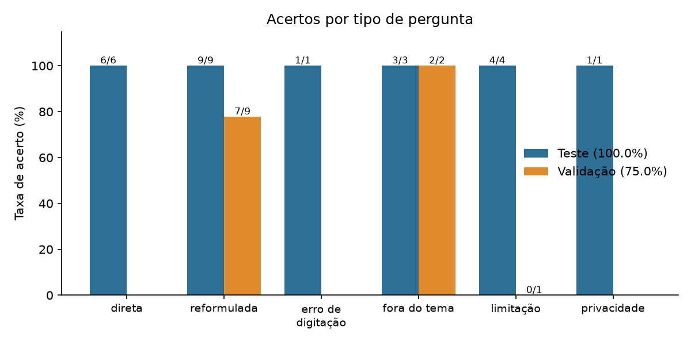

# Resultados da avaliação

Gerado automaticamente por `python src/avaliacao.py`. Os números abaixo são da última execução.

## Indicadores gerais

| Indicador | Teste | Validação |
|---|---|---|
| Perguntas | 24 | 12 |
| Acertos | 24 | 9 |
| **Taxa de acerto** | **100.0%** | **75.0%** |
| Tempo médio de consulta | 0.3074 ms | 0.2482 ms |
| Tempo mediano | 0.1562 ms | 0.1456 ms |
| Tempo máximo | 0.9005 ms | 0.5364 ms |

Carregamento e indexação da base: 5.45 ms. Cada pergunta foi executada 30 vezes e o tempo registrado é a média.

## Perguntas de teste

| n | tipo | pergunta | esperado | id_esperado | obtido | id_obtido | pontuacao | acerto | tempo_ms |
|---|---|---|---|---|---|---|---|---|---|
| 1 | direta | Como faço a nova carteira de identidade? | respondida | DOC01 | respondida | DOC01 | 0.9551 | acerto | 0.1401 |
| 2 | direta | Como consultar a situação do meu CPF? | respondida | DOC02 | respondida | DOC02 | 0.6806 | acerto | 0.1245 |
| 3 | direta | Onde baixo o título de eleitor digital? | respondida | DOC03 | respondida | DOC03 | 1.0 | acerto | 0.153 |
| 4 | direta | Como pedir seguro-desemprego? | respondida | SER02 | respondida | SER02 | 0.8753 | acerto | 0.1594 |
| 5 | direta | Qual o telefone do INSS? | respondida | SER04 | respondida | SER04 | 0.8121 | acerto | 0.1127 |
| 6 | direta | Onde reclamar de uma empresa pela internet? | respondida | DIR03 | respondida | DIR03 | 0.7475 | acerto | 0.1334 |
| 7 | reformulada | Perdi o papel do meu nascimento, como consigo outro? | respondida | DOC05 | respondida | DOC05 | 0.3671 | acerto | 0.1564 |
| 8 | reformulada | Me mandaram embora da empresa, recebo alguma ajuda do governo? | respondida | SER02 | respondida | SER02 | 0.2556 | acerto | 0.5775 |
| 9 | reformulada | Comprei um tênis no site e me arrependi, dá pra devolver? | respondida | DIR01 | respondida | DIR01 | 0.2761 | acerto | 0.6202 |
| 10 | reformulada | A geladeira que comprei parou de funcionar, a loja tem que trocar? | respondida | DIR02 | respondida | DIR02 | 0.5453 | acerto | 0.9005 |
| 11 | reformulada | Não tenho condições de pagar um advogado | respondida | DIR04 | respondida | DIR04 | 0.5556 | acerto | 0.1561 |
| 12 | reformulada | Está chovendo muito e o barranco atrás de casa pode cair | respondida | COM02 | respondida | COM02 | 0.3172 | acerto | 0.524 |
| 13 | reformulada | Vi um idoso sendo maltratado pelo vizinho, como denuncio? | respondida | COM03 | respondida | COM03 | 0.3228 | acerto | 0.807 |
| 14 | reformulada | Como faço para receber o Bolsa Família? | respondida | SER03 | respondida | SER03 | 0.8333 | acerto | 0.1702 |
| 15 | reformulada | A carteirinha do SUS mudou para o número do CPF? | respondida | SER05 | respondida | SER05 | 0.5946 | acerto | 0.156 |
| 16 | erro_digitacao | como pedir o seguro desenprego | respondida | SER02 | respondida | SER02 | 0.6253 | acerto | 0.4891 |
| 17 | fora_do_tema | Qual a previsão do tempo para amanhã? | sem_resposta |  | sem_resposta |  | 0.0 | acerto | 0.5224 |
| 18 | fora_do_tema | Como renovar o passaporte? | sem_resposta |  | sem_resposta |  | 0.0 | acerto | 0.8096 |
| 19 | fora_do_tema | Me passa uma receita de bolo de cenoura | sem_resposta |  | sem_resposta |  | 0.1907 | acerto | 0.464 |
| 20 | limitacao |  | invalida |  | invalida |  | 0.0 | acerto | 0.0003 |
| 21 | limitacao | ???!! | invalida |  | invalida |  | 0.0 | acerto | 0.0024 |
| 22 | limitacao | carteira | ambigua |  | ambigua | DOC01/DOC04 | 0.6667 | acerto | 0.0219 |
| 23 | limitacao | Quero denunciar uma violência | ambigua |  | ambigua | COM03/COM04 | 0.75 | acerto | 0.0312 |
| 24 | privacidade | Meu CPF é 123.456.789-09, ele está regular? | respondida | DOC02 | respondida | DOC02 | 0.4334 | acerto | 0.1466 |

## Perguntas de validação (não usadas no ajuste)

| n | tipo | pergunta | esperado | id_esperado | obtido | id_obtido | pontuacao | acerto | tempo_ms |
|---|---|---|---|---|---|---|---|---|---|
| 1 | reformulada | Minha CTPS física ainda serve para alguma coisa? | respondida | DOC04 | respondida | DOC04 | 0.5 | acerto | 0.133 |
| 2 | reformulada | Como sei onde vou votar? | respondida | DOC03 | respondida | DOC03 | 0.4016 | acerto | 0.1452 |
| 3 | reformulada | Quanto custa a primeira via do RG novo? | respondida | DOC01 | respondida | DOC01 | 0.3689 | acerto | 0.146 |
| 4 | reformulada | Como deixo minha conta do gov mais segura com selo ouro? | respondida | SER01 | respondida | SER01 | 0.2792 | acerto | 0.1782 |
| 5 | reformulada | Meu pai quer dar entrada na aposentadoria, por onde começa? | respondida | SER04 | sem_resposta |  | 0.1439 | erro | 0.5209 |
| 6 | reformulada | Pedi um produto pelo telefone e quero cancelar | respondida | DIR01 | sem_resposta |  | 0.1647 | erro | 0.0908 |
| 7 | reformulada | Tem incêndio no prédio ao lado! | respondida | COM01 | respondida | COM01 | 0.3539 | acerto | 0.4747 |
| 8 | reformulada | Estou sofrendo violência doméstica, onde peço ajuda? | respondida | COM04 | respondida | COM04 | 0.5715 | acerto | 0.5364 |
| 9 | reformulada | A empresa não respondeu minha reclamação, e agora? | respondida | DIR03 | respondida | DIR03 | 0.5556 | acerto | 0.1391 |
| 10 | fora_do_tema | Como faço para tirar a CNH? | sem_resposta |  | sem_resposta |  | 0.0 | acerto | 0.0685 |
| 11 | fora_do_tema | Qual o melhor time do Brasil? | sem_resposta |  | sem_resposta |  | 0.0 | acerto | 0.4316 |
| 12 | limitacao | documento | ambigua |  | respondida | DOC01 | 0.6667 | erro | 0.1139 |

## Comparação dos modelos de resposta

Percentual das respostas que cumprem cada critério (17 respostas do conjunto de teste).

| Critério | Modelo A (direto) | Modelo B (estruturado) |
|---|---|---|
| Cita o link da fonte (%) | 100.0 | 100.0 |
| Cita o órgão da fonte (%) | 0.0 | 100.0 |
| Mostra a data de verificação (%) | 0.0 | 100.0 |
| Mostra o aviso quando a orientação exige confirmação (%) | 47.1 | 100.0 |
| Organizado em tópicos (%) | 0.0 | 100.0 |
| **Média do checklist (%)** | 29.4 | 100.0 |
| Palavras por frase (menor = mais simples) | 12.4 | 10.1 |
| Índice de legibilidade Flesch-PT (maior = mais fácil) | 60.4 | 59.5 |
| Sem resposta: explica o limite (%) | 0.0 | 100.0 |
| Sem resposta: indica outro caminho (%) | 0.0 | 100.0 |

## Roteiro de tarefas de usabilidade (execução automatizada)

| id | tarefa | passos | concluida | mensagens_de_erro |
|---|---|---|---|---|
| T1 | Descobrir o telefone do INSS fazendo uma pergunta | 2 | sim | 0 |
| T2 | Achar o direito de arrependimento navegando pelos temas | 4 | sim | 0 |
| T3 | A partir de uma resposta, abrir um assunto relacionado | 3 | sim | 0 |
| T4 | Fazer uma pergunta fora do tema e entender o aviso | 3 | sim | 0 |
| T5 | Resolver uma pergunta ambígua escolhendo a opção certa | 3 | sim | 0 |
| T6 | Trocar para o formato de resposta curto | 1 | sim | 0 |

A avaliação por percurso cognitivo está em `docs/teste_usabilidade.md`.
